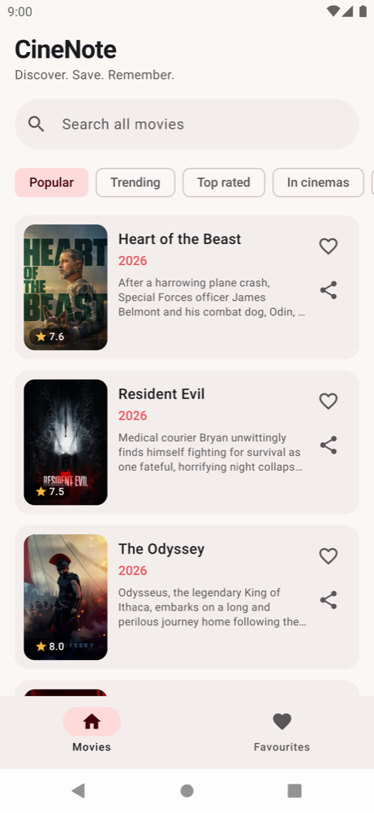
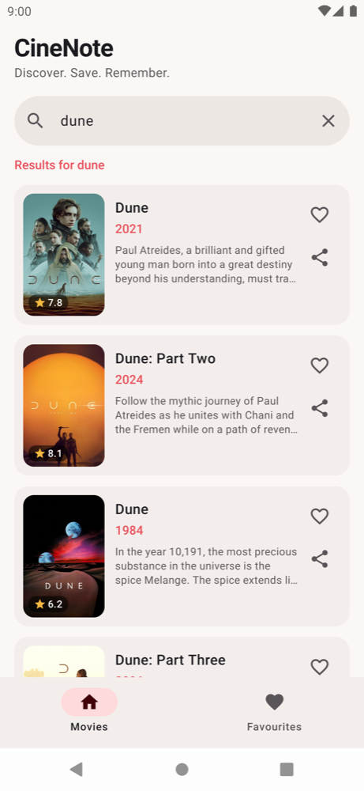
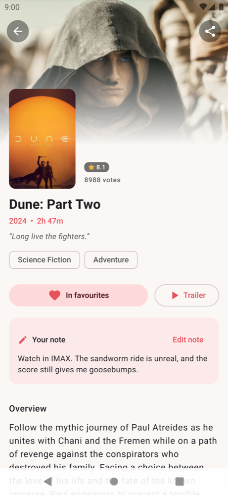
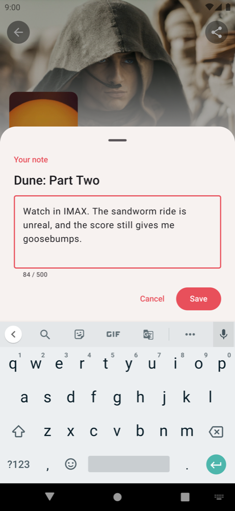
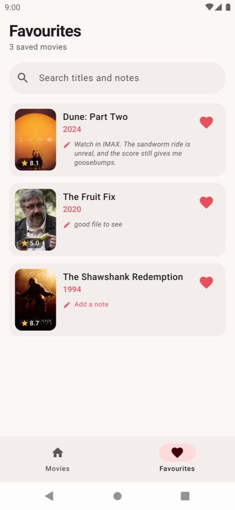
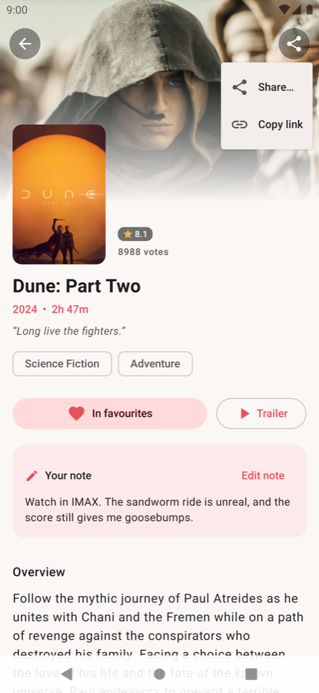
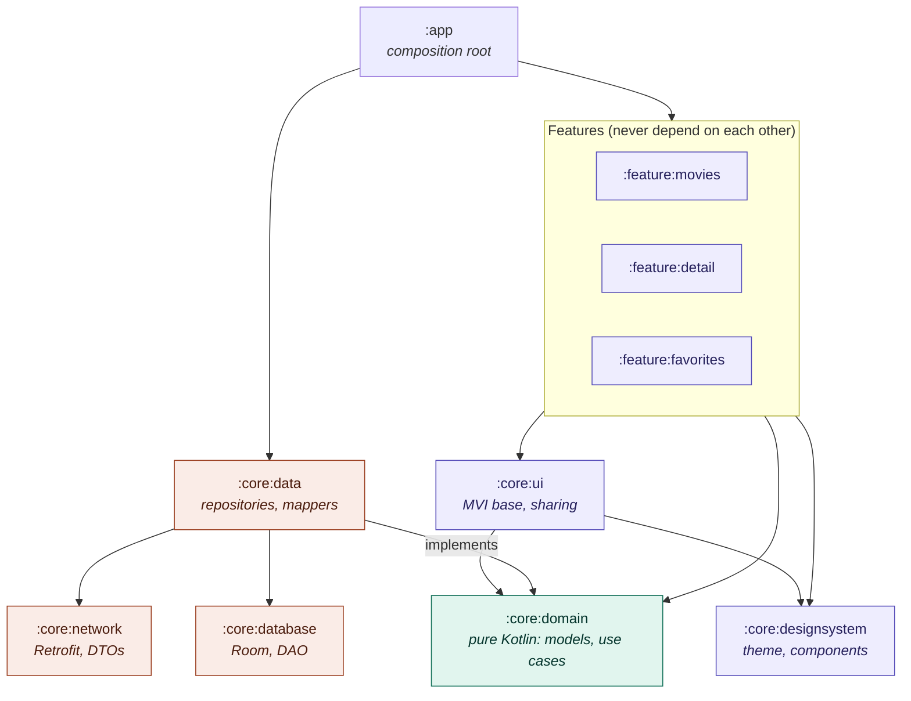

<div align="center">

# 🎬 CineNote

**Discover. Save. Remember.**

A movie companion app for Android: browse and search the whole [TMDB](https://www.themoviedb.org) catalogue,
keep your favourites, and write a personal note about each one, all saved on your device.

Built as a showcase of **modern Android architecture**: Clean Architecture, SOLID, MVI, Jetpack Compose,
Hilt, type-safe Navigation, Paging 3, Room, and **unit tests for every layer**.

[](https://github.com/raminduw/movie-showcase/actions/workflows/ci.yml)


</div>

---

## 📱 Screenshots

<table>
  <tr>
    <td align="center"><br/><sub><b>Browse</b>: categories, infinite scroll</sub></td>
    <td align="center"><br/><sub><b>Search</b>: the whole TMDB catalogue</sub></td>
    <td align="center"><br/><sub><b>Details</b>: cast, trailer, your note</sub></td>
  </tr>
  <tr>
    <td align="center"><br/><sub><b>Notes</b>: a personal summary, saved locally</sub></td>
    <td align="center"><br/><sub><b>Favourites</b>: search titles <i>and</i> notes</sub></td>
    <td align="center"><br/><sub><b>Share</b>: share sheet or copy link</sub></td>
  </tr>
</table>

## ✨ Features

| | |
|---|---|
| 🚀 **Splash** | Android 12+ SplashScreen API with an animated film-frame and heart icon, and a zoom-out exit |
| 🎞️ **Browse** | Popular · Trending · Top rated · In cinemas · Upcoming, with infinite scroll (Paging 3) and shimmer skeleton loading |
| 🔍 **Search** | Searches the whole TMDB catalogue, debounced, cancelling stale requests |
| ❤️ **Favourites** | Toggle from any screen, swipe to remove, **Undo** restores the note too |
| 📝 **Notes** | A short personal note per favourite (500-character limit); the Favourites search covers your notes |
| 🎬 **Details** | Backdrop header, **shared-element poster animation**, genres, runtime, cast, trailer, similar movies |
| 🔗 **Share** | System share sheet with a short message plus the TMDB link, or copy just the link |
| 🌗 **Theming** | Material 3 light and dark themes with a custom "cinema" palette |
| 📶 **Resilient** | Clear loading, empty, offline and invalid-token states with retry; DNS-timeout guard |

## 🏗️ Architecture

Clean Architecture in **11 Gradle modules**. Every dependency points inward, toward a pure-Kotlin domain.



**Data flow (one direction):**

```
TMDB JSON ─▶ MovieDto ─(mapper)─▶ Movie (domain) ─(UI mapper)─▶ MovieUi ─▶ Compose
Room row  ─▶ FavoriteEntity ─(mapper)─▶ FavoriteMovie (domain) ─▶ FavoriteUi ─▶ Compose

UI ──Action──▶ ViewModel ──▶ UseCase ──▶ Repository (interface) ──▶ API / DAO
UI ◀──State (StateFlow)── ViewModel ──Effect (Channel)──▶ navigation, snackbar, share
```

<details>
<summary><b>Module responsibilities</b></summary>

| Module | Responsibility |
|---|---|
| `core:domain` | Models, repository contracts, use cases. **No Android.** |
| `core:data` | `TmdbMovieRepository`, `OfflineFavoritesRepository`, mappers, `TmdbPagingSource`, error mapping |
| `core:network` | `TmdbApi` (Retrofit), DTOs, `AuthInterceptor`, `TimeoutDns` |
| `core:database` | Room `FavoriteEntity`, `FavoriteDao` |
| `core:designsystem` | Theme, `MoviePoster`, `FavoriteButton`, shimmer, `NoteEditorSheet`, light/dark previews |
| `core:ui` | `MviViewModel`, `ObserveEffects`, `ShareMenuButton`, `Formatters`, error → message |
| `core:testing` | Fakes (`FakeMovieRepository`, `FakeFavoritesRepository`), `MainDispatcherExtension`, `TestData` |
| `feature:*` | One screen each: Contract (State/Action/Effect), ViewModel, UI mapper, Screen, type-safe route |
| `build-logic` | Gradle convention plugins (`cinenote.android.feature`, `cinenote.hilt`, …) |

</details>

## 🧱 SOLID in this codebase

| Principle | Where to look |
|---|---|
| **S**ingle responsibility | One use case per action (`ToggleFavoriteUseCase`, `UpdateFavoriteNoteUseCase`, `CreateMovieShareUseCase`…). Mappers only map, DAOs only query, composables only render state. |
| **O**pen/closed | `TmdbPagingSource` takes a `fetchPage` lambda, so a new list needs no change to the paging code. |
| **L**iskov substitution | `FakeFavoritesRepository` and `OfflineFavoritesRepository` are interchangeable; ViewModel tests run real use cases on fakes. |
| **I**nterface segregation | `FavoritesReader` and `FavoritesWriter` are separate: `ObserveFavoritesUseCase` can't write, and `RestoreFavoriteUseCase` can't read. |
| **D**ependency inversion | The domain owns `MovieRepository` and friends; `:core:data` implements them; Hilt `@Binds` wires them. Features never see Retrofit or Room. |

## 🧪 Testing

```bash
./gradlew test
```

| Layer | What's tested | How |
|---|---|---|
| Domain | Every use case: validation, trimming, toggle, undo, note rules, share links | JUnit 5 + fakes |
| Network | Paths, query params, auth (Bearer / api_key), JSON parsing, HTTP errors, DNS timeout | **MockWebServer** + JSON fixtures |
| Database | Real SQL: upsert, ordering, title/note search, reactive `Flow`s | **Robolectric** + in-memory Room |
| Data | DTO/entity mappers, error mapping, paging keys and de-duplication, repositories | MockK |
| Presentation | ViewModels (state, effects, debounce, undo, notes, share), UI mappers, formatters | Turbine + `MainDispatcherExtension` |

Stack: JUnit 5 (parameterised and nested tests) · Truth · MockK · Turbine · kotlinx-coroutines-test · Paging testing.

## 🚀 Getting started

1. Get a free **API Read Access Token** (or API Key) at <https://www.themoviedb.org/settings/api>.
2. Add it to `local.properties` (git-ignored, never committed):
   ```properties
   TMDB_TOKEN=eyJhbGciOi...
   ```
3. Open in Android Studio and press ▶, or run:
   ```bash
   ./gradlew :app:installDebug
   ```

> **Emulator can't reach TMDB?** If DNS fails inside the emulator (common on VPNs or with IPv6 DNS), start it with
> `emulator -avd <name> -dns-server 8.8.8.8`.

## 🛠️ Tech stack

| | |
|---|---|
| Language | Kotlin 2.2, Coroutines & Flow |
| UI | Jetpack Compose, Material 3, Coil 3, SplashScreen API, shared-element transitions |
| Architecture | Clean Architecture, MVI (State / Action / Effect), multi-module |
| DI | Hilt (KSP) |
| Navigation | Navigation Compose with type-safe `@Serializable` routes |
| Data | Retrofit, OkHttp, kotlinx.serialization, Paging 3, Room |
| Build | Gradle version catalog, convention plugins (`build-logic`), GitHub Actions CI |
| Testing | JUnit 5, MockK, Truth, Turbine, MockWebServer, Robolectric |

## 🗺️ Ideas for next steps

- Compose UI and screenshot tests (Roborazzi)
- detekt / ktlint in CI
- Offline cache for the movie lists (`RemoteMediator`)
- Settings in DataStore (language, region, theme)
- Baseline Profiles

---

<div align="center">
<sub>This product uses the TMDB API but is not endorsed or certified by TMDB.</sub>
</div>
